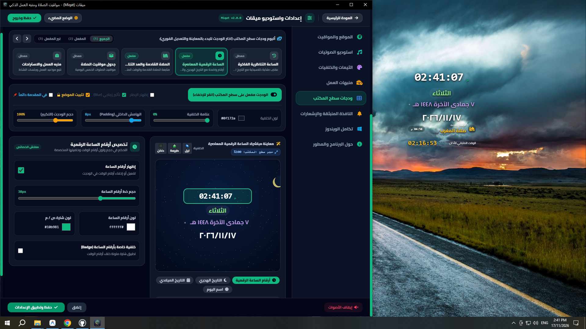
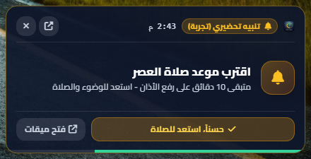
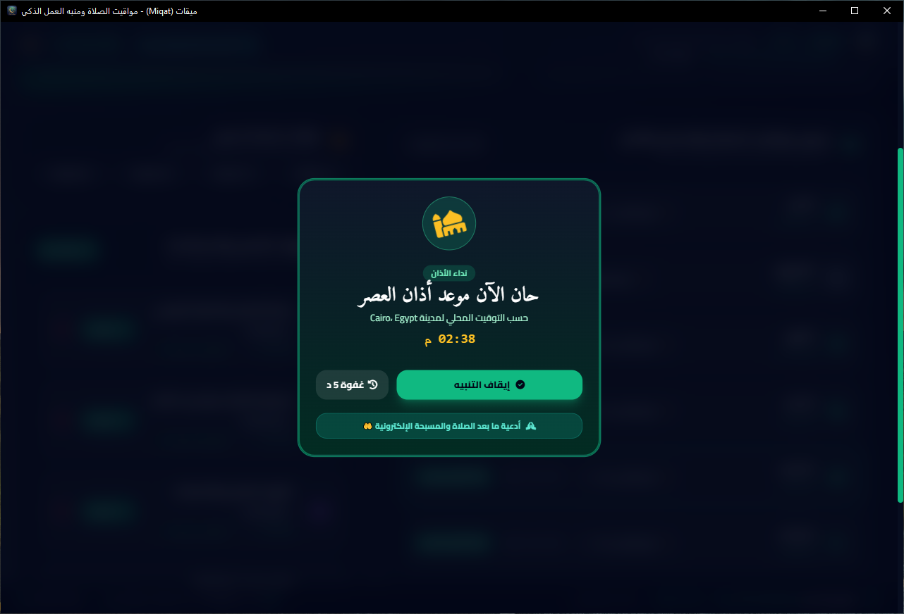
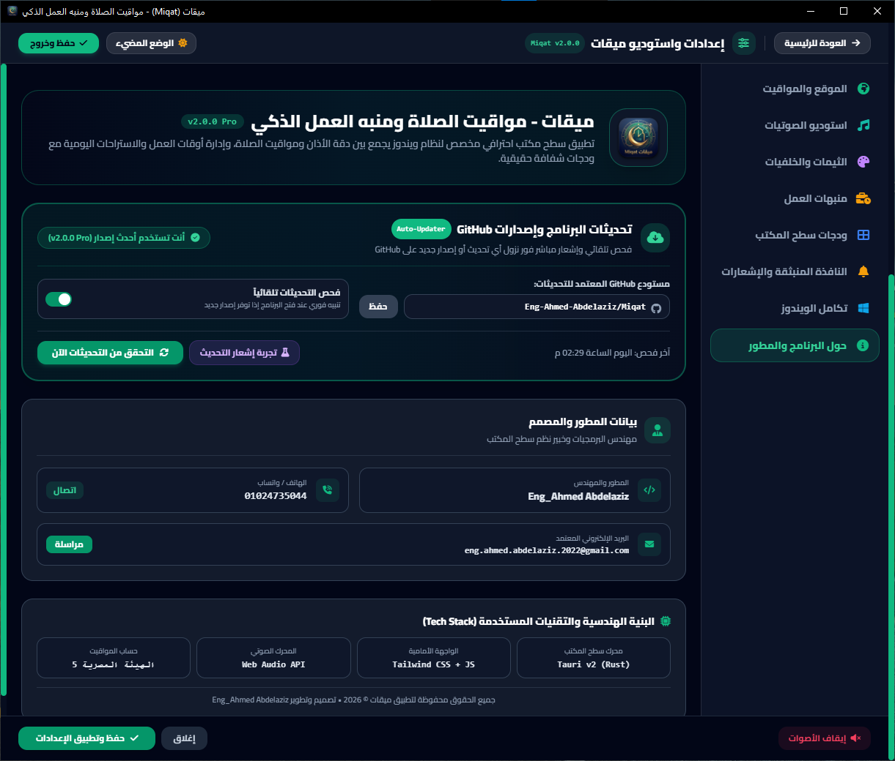
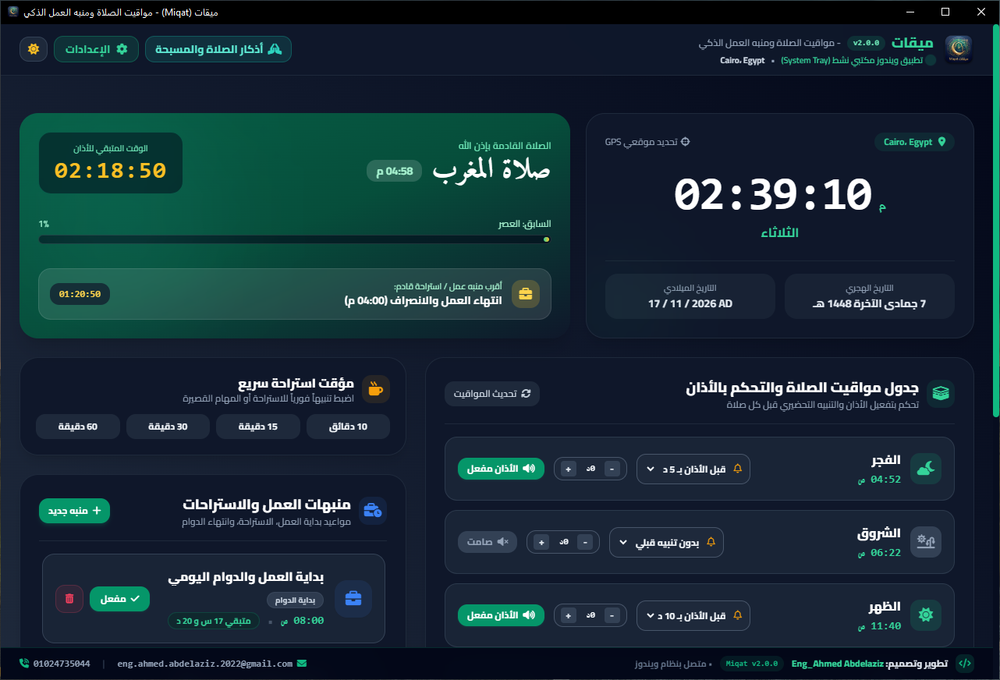
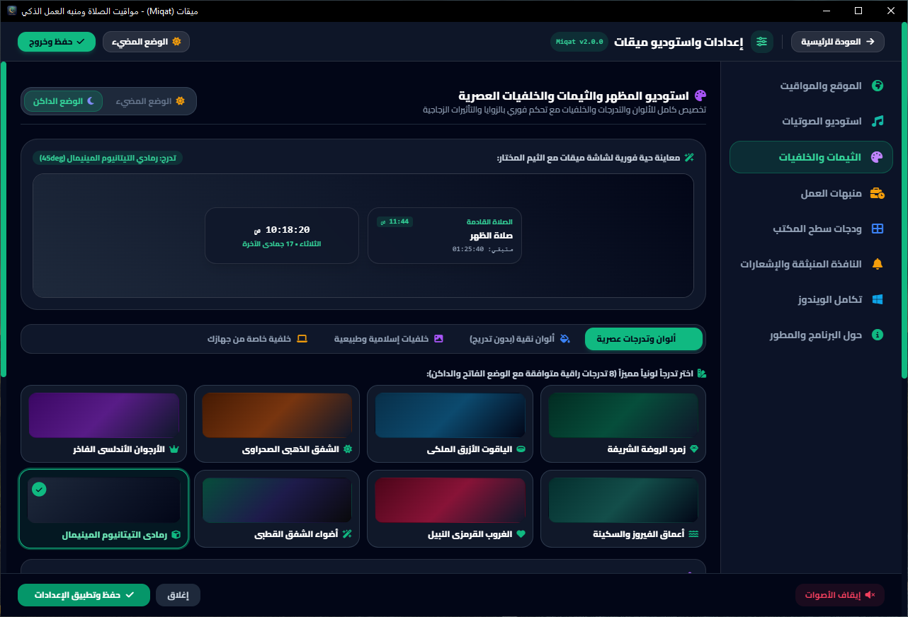

# 🕌 ميقات (Miqat) v2.0 Pro
> **مواقيت الصلاة ومنبه العمل والإنتاجية الذكي لسطح المكتب | Desktop Prayer Times & Smart Work Companion**
>
> تطبيق سطح مكتب احترافي لنظام ويندوز (Windows 10 / 11) مبني بأحدث التقنيات باستخدام **Tauri v2** ونواة خلفية فائقة السرعة والخفة بلغة **Rust 2024**، مع واجهة مستخدم زجاجية عصرية (Acrylic Glassmorphism) استناداً إلى **Tailwind CSS**.

---

## 🌟 نظرة عامة شاملة على البرنامج (Application Overview)


---

## ✨ المميزات الرئيسية لتطبيق ميقات

### 1. 🕋 مواقيت الصلاة والأذان التلقائي لـ 22 دولة عربية
- حساب فلكي دقيق معتمد لأكثر من **22 دولة عربية وإسلامية** (الهيئة المصرية العامة للمساحة، أم القرى بمكة المكرمة، دبي، قطر، الشؤون الدينية بتركيا، رابطة العالم الإسلامي، وغيرها).
- عد تنازلي حي وشريط تقدم يوضح الوقت المتبقي لرفع الأذان القادم بدقة متناهية.
- تنبيه مسبق قبل دخول وقت الصلاة (5 إلى 30 دقيقة) للاستعداد والوضوء.
- إمكانية التعديل اليدوي بالدقائق (+/-) لكل صلاة والبوصلة المدمجة لتحديد اتجاه القبلة.

### 2. 💼 منبهات العمل والإنتاجية ومؤقت الاستراحة
- جدولة مرنة لمواعيد بدء الدوام اليومي، فترات الاستراحة وتجديد النشاط، وموعد الانصراف.
- مؤقت استراحة سريع (Pomodoro) بنقرة واحدة لفترات (10، 15، 30، 60 دقيقة) للمحافظة على صحة العين وتجديد النشاط.
- جدول تفاعلي منظم يملأ الواجهة السفلية بسلاسة مع إمكانية التفعيل والإيقاف الفوري.

### 3. 🪟 النوافذ المنبثقة الزجاجية التفاعلية (Acrylic Desktop Popups)
- نافذة منبثقة ذكية بتصميم زجاجي أكريليك تظهر في الركن الأيمن السفلي فوق شريط المهام في ويندوز.
- معادل صوت حي وتفاعلي (**Live Audio Equalizer**) يتجاوب في الوقت الفعلي أثناء رفع صوت الأذان.
- أزرار تحكم مباشرة وسريعة: إيقاف التنبيه، تشغيل دعاء الأذان، أو الغفوة لمدة 5 دقائق.
- تصميم مخصص لكل نوع إشعار: للأذان، لمنبهات العمل، وللتنبيه المسبق للوضوء.

### 4. 🕒 ودجات سطح المكتب الشفافة الحرة (Floating Desktop Widgets)
- ساعات رقمية وكلاسيكية مدمجة بنفاذية زجاجية نقية حقيقية تتكامل بانسجام مع خلفيات سطح المكتب.
- دعم السحب والإفلات والتحريك الحر (**Free Drag & Drop**) في أي مكان على الشاشة أو التثبيت في موضع محدد.
- عرض الوقت اللحظي، التاريخ الهجري والميلادي، واسم الصلاة القادمة مع العد التنازلي المباشر.

### 5. 🎙️ استوديو الصوتيات والسبحة الإلكترونية والأذكار
- مكتبة أذان صوتية كاملة تضم 6 تسجيلات لأشهر مؤذني الحرم المكي والحرم المدني والمسجد الأقصى والشيخ عبد الباسط ومشاري العفاسي وناصر القطامي.
- باقة أدعية نبوية مسموعة عالية النقاوة (دعاء ما بعد الأذان كامل، خواتيم سورة البقرة، آية الكرسي، دعاء ذي النون، ربنا آتنا في الدنيا حسنة).
- سبحة إلكترونية رقمية ذكية مع عداد تفاعلي بنقرات هابتك وتحديد الأهداف (33 / 100 تسبيحة).
- قائمة أذكار ما بعد الصلاة الصحيحة المأثورة عن النبي ﷺ بتنسيق بصري مريح.

### 6. ⚡ التحديثات التلقائية وخفة استهلاك الموارد
- فحص ذكي وتلقائي للإصدارات الجديدة عبر **GitHub Releases** مع نافذة مخصصة للتحديث بنقرة زر واحدة.
- خفيف للغاية على موارد النظام (استهلاك الذاكرة العشوائية أقل من 40 ميجابايت) بفضل محرك Rust.
- تشغيل صامت في شريط المهام (System Tray) مع ميزة بدء التشغيل التلقائي مع إقلاع الويندوز.

---

## 📸 معرض الصور الحقيقية للبرنامج (Official Screenshots)

### أولاً: ودجات سطح المكتب الحرة (Floating Desktop Widgets)
| سطح مكتب ويندوز مع الودجات الحرة المدمجة | ودجت الساعة الرقمية والعد التنازلي للصلاة |
| :---: | :---: |
|  |  |

---

### ثانياً: النوافذ المنبثقة الذكية فوق شريط المهام (Acrylic Desktop Popups)
| نافذة الأذان المنبثقة مع المعادل الصوتي الحي | نافذة منبه العمل والإنتاجية | نافذة التنبيه المسبق للوضوء |
| :---: | :---: | :---: |
|  |  |  |

---

### ثالثاً: تنبيه الأذان والسبحة الإلكترونية والأذكار (Adhan & Azkar Modals)
| نافذة رفع الأذان الرئيسية | السبحة الإلكترونية الذكية | قائمة أذكار ما بعد الصلاة الصحيحة |
| :---: | :---: | :---: |
|  |  |  |

---

### رابعاً: استوديو الإعدادات والتخصيص (Settings & Customization Studio)
| إعدادات المواقع والدول والحساب الفلكي | استوديو الصوتيات والأذان والأدعية |
| :---: | :---: |
|  |  |

| تخصيص الثيمات وخلفيات المساجد والشفافية | ألبوم ودجات سطح المكتب وخيارات التثبيت |
| :---: | :---: |
|  |  |

---

## 🛠️ البنية الهندسية والتقنيات المستخدمة (Technical Architecture)

- **نواة النظام الخلفية (Backend Engine):** Rust 2024 / Tauri v2 Native Desktop Framework.
- **الواجهة الأمامية (Frontend):** Tailwind CSS 3.4 & High-Performance Vanilla JavaScript.
- **معالجة الصوتيات (Audio Engine):** Web Audio API مع فك تشفير وتوليد ذبذبات صوتية حية.
- **واجهة ويندوز الأصيلة (Windows Integration):** دعم الشفافية الأكريليكية (Acrylic Blur)، قفل النسخة الواحدة (Single Instance Lock)، واختصارات لوحة المفاتيح العامة.
- **التخزين الداخلي (Local Persistence):** LocalStorage & IndexedDB (يعمل بالكامل بدون الحاجة لإنترنت - Offline First).
- **التوافق وأنظمة التشغيل:** Windows 10 و Windows 11 (معماريات 64-bit).

---

## 🚀 التشغيل والتثبيت (Getting Started)

### تشغيل النسخة الجاهزة المحمولة (Portable Executable)
يمكنك تنزيل وتشغيل ملف `Miqat.exe` مباشرة بدون الحاجة لأي خطوات تثبيت معقدة.

### البناء والتجميع من المصدر (Build from Source)
1. تأكد من توفر بيئة **Node.js** (v18+) وبيئة **Rust** (v1.75+).
2. تثبيت الحزم والاعتماديات:
   ```bash
   npm install
   ```
3. تشغيل وضع التطوير والمراقبة الحية:
   ```bash
   npm run tauri dev
   ```
4. تجميع وبناء ملف التشغيل النهائي عالي الأداء:
   ```bash
   npm run tauri build
   ```

---

## 👨‍💻 بيانات المطور والمصمم الرئيسي (Developer & Contact Info)

- **المطور والمصمم:** المهندس أحمد عبد العزيز (**Eng_Ahmed Abdelaziz**)
- **المسمى المهني:** مهندس البرمجيات وخبير نظم سطح المكتب
- **الهاتف / واتساب:** `01024735044` (من داخل مصر) / `+201024735044` (دولي)
- **البريد الإلكتروني الرسمي:** `eng.ahmed.abdelaziz.2022@gmail.com`
- **مستودع المشروع على GitHub:** [https://github.com/Eng0Ahmed/Miqat](https://github.com/Eng0Ahmed/Miqat)

---

> **الحقوق والترخيص:** جميع حقوق تطوير وتصميم تطبيق ميقات محفوظة للمطور © 2026. البرنامج متاح ومفتوح المصدر لخدمة المستخدمين والمسلمين حول العالم.
