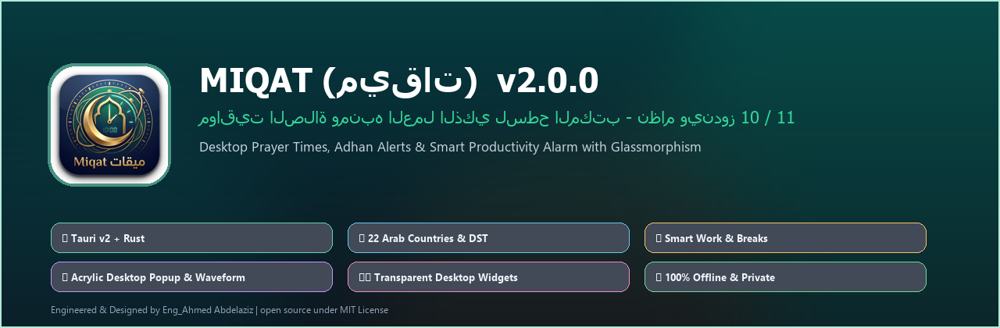
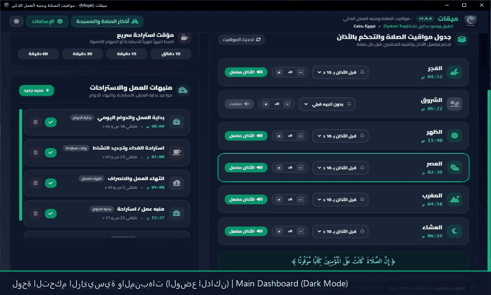
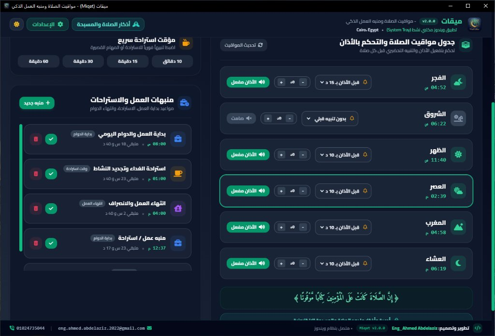
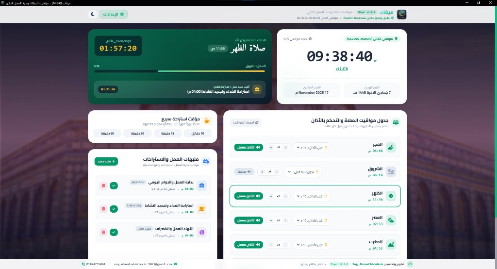
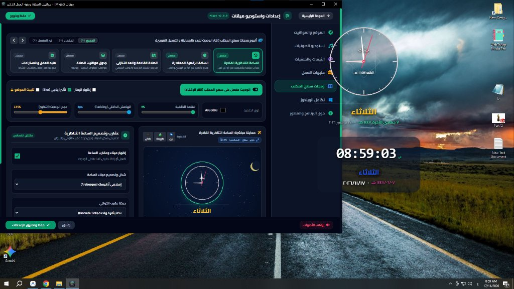
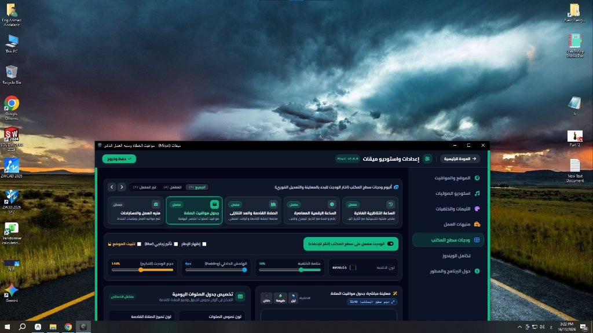
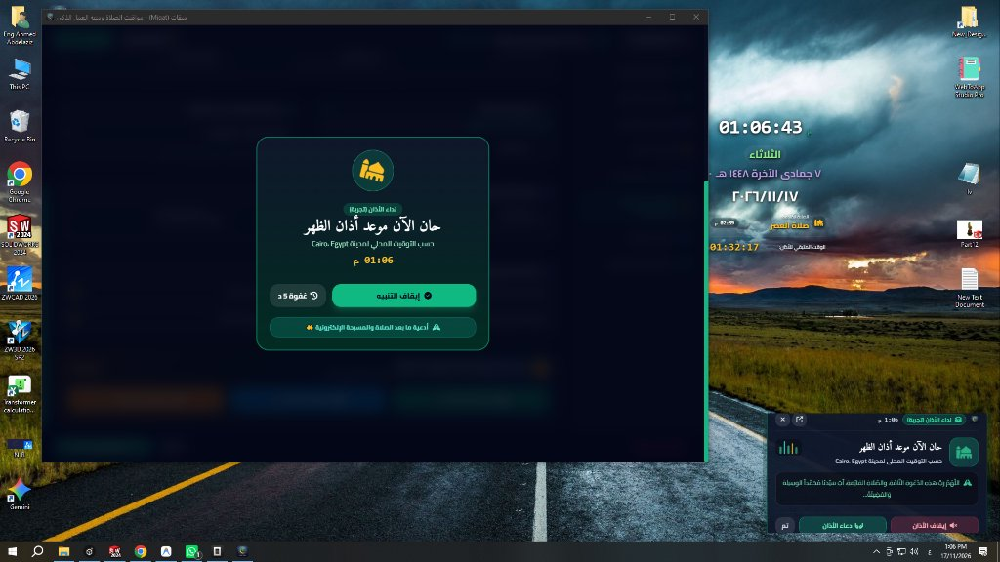
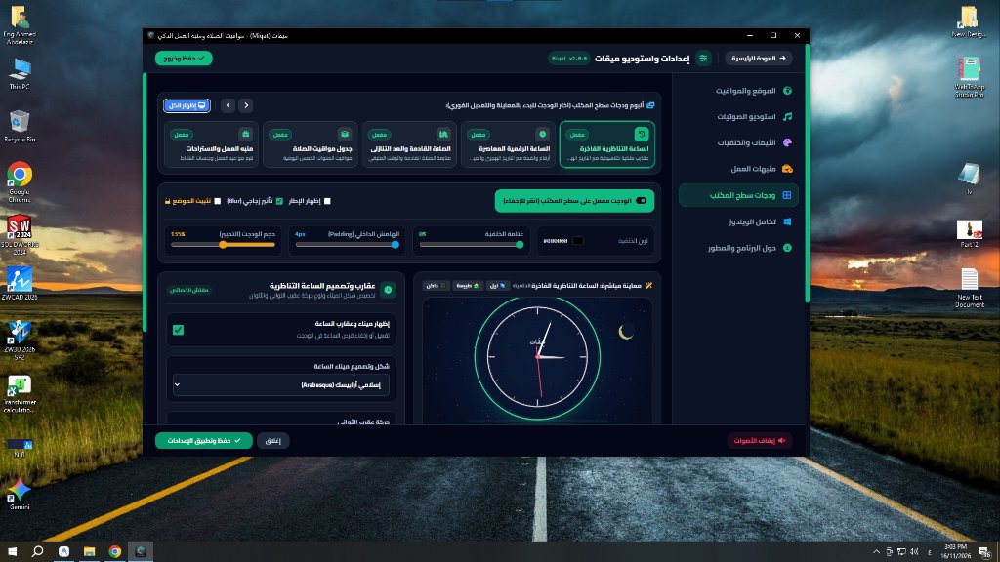

# 🕌 ميقات | Miqat v2.0
> **مواقيت الصلاة ومنبه العمل الذكي لسطح المكتب | Desktop Prayer Times & Smart Productivity Alarm**
> 
> تطبيق سطح مكتب حديث لنظام ويندوز 10 / 11 مبني باستخدام **Tauri v2** ونواة خلفية بلغة **Rust** مع واجهة عصرية بتقنيات الويب بنمط الزجاج المعتم (Glassmorphism).

---



---

## 📽️ العرض التوضيحي السريع (Showcase Preview)



> 🎥 **فيديو توضيحي عالي الدقة (Full HD 1080p):** يمكنك مشاهدة أو تحميل الفيديو الاستعراضي التوضيحي الشامل للبرنامج من الرابط: [assets/github/miqat-showcase.mp4](assets/github/miqat-showcase.mp4).

---

## ✨ المميزات الرئيسية للبرنامج

### 1. مواقيت الصلاة والأذان التلقائي
- دعم كامل لحساب مواقيت الصلاة لـ **22 دولة عربية** مع إمكانية التحديد اليدوي أو عبر GPS.
- دعم **التوقيت الصيفي** وإمكانية تفعيله أو تعطيله بنقرة زر.
- عداد تنازلي حي وشريط تقدم يوضح الوقت المتبقي لرفع الأذان.
- تنبيه تحضيري قبل الأذان بوقت كافٍ للاستعداد للصلاة.
- نافذة مخصصة لأدعية ما بعد الصلاة مع مسبحة إلكترونية تفاعلية.

### 2. منبهات العمل والإنتاجية ومؤقت الاستراحة
- إنشاء ومتابعة منبهات الدوام، الاستراحات، ومواعيد المهام اليومية.
- مؤقت استراحة سريع (Pomodoro) لفترات (10، 15، 30، 60 دقيقة).
- شريط تحكم ذكي يعرض المنبهات النشطة مع إمكانية تفعيل أو كتم الكل بضغطة زر.

### 3. النافذة المنبثقة التفاعلية (Desktop Popup Notification)
- نافذة بتصميم زجاجي أكريليك تظهر أعلى ساعة شريط المهام في ويندوز.
- محاكي ذبذبات صوتية تفاعلي (Equalizer) يتجاوب مع الصوت.
- أزرار مباشرة لإيقاف التنبيه، تشغيل الدعاء، أو الغفوة لمدة 5 دقائق.
- 6 خيارات لموضع الظهور على الشاشة مع التحكم الكامل في الأبعاد والشفافية.


### 4. ودجات سطح المكتب الشفافة الحرة (Desktop Floating Widgets)
- ساعة رقمية حرة وساعة تناظرية بعقارب كلاسيكية وميناء إسلامي.
- دعم السحب والإفلات وتثبيت الموضع في أي مكان على سطح المكتب.
- حفظ تلقائي للمواقع والأحجام والألوان مع خيارات مخصصة للشفافية.

---

## 📸 معرض الصور (Screenshots Gallery)

| لوحة التحكم الرئيسية (الوضع الداكن) | لوحة التحكم (الوضع الفاتح) |
| :---: | :---: |
|  |  |

| استوديو ودجات سطح المكتب | استوديو الصوتيات والأدعية |
| :---: | :---: |
|  |  |

| النافذة المنبثقة على سطح المكتب | إعدادات المواقع والدول العربية |
| :---: | :---: |
|  |  |

---

## 🛠️ التقنيات المستخدمة (Tech Stack)

- **Backend:** Rust 2024, Tauri v2
- **Frontend:** HTML5, Tailwind CSS, Vanilla JavaScript
- **Audio:** Web Audio API & Native Media Playback
- **Storage:** LocalStorage & IndexedDB (Offline-first architecture)
- **Platforms:** Windows 10 / Windows 11 (64-bit)

---

## 🚀 التشغيل والتثبيت (Getting Started)

### تشغيل النسخة الجاهزة (Portable EXE)
يمكنك تشغيل ملف `Miqat.exe` مباشرة دون الحاجة لأي تثبيت مسبق.

### البناء من المصدر (Build from Source)
1. تأكد من تثبيت بيئة **Rust** و **Node.js**.
2. تثبيت الاعتماديات:
   ```bash
   npm install
   ```
3. تشغيل وضع التطوير:
   ```bash
   npm run tauri dev
   ```
4. بناء النسخة النهائية:
   ```bash
   npm run tauri build
   ```

---

## 👨‍💻 المطور وبيانات التواصل (Author & Credits)

- **تطوير وتصميم:** م. أحمد عبد العزيز (Eng_Ahmed Abdelaziz)
- **هاتف / واتساب:** `01024735044`
- **البريد الإلكتروني:** `eng.ahmed.abdelaziz.2022@gmail.com`
- **الترخيص:** مفتوح المصدر للاستخدام الشخصي والتطوير البرمجي.
