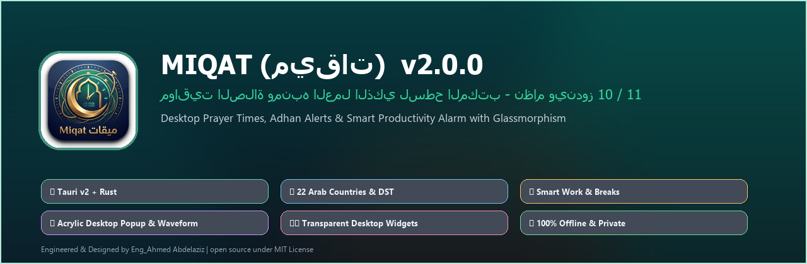
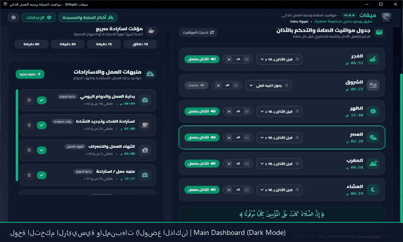
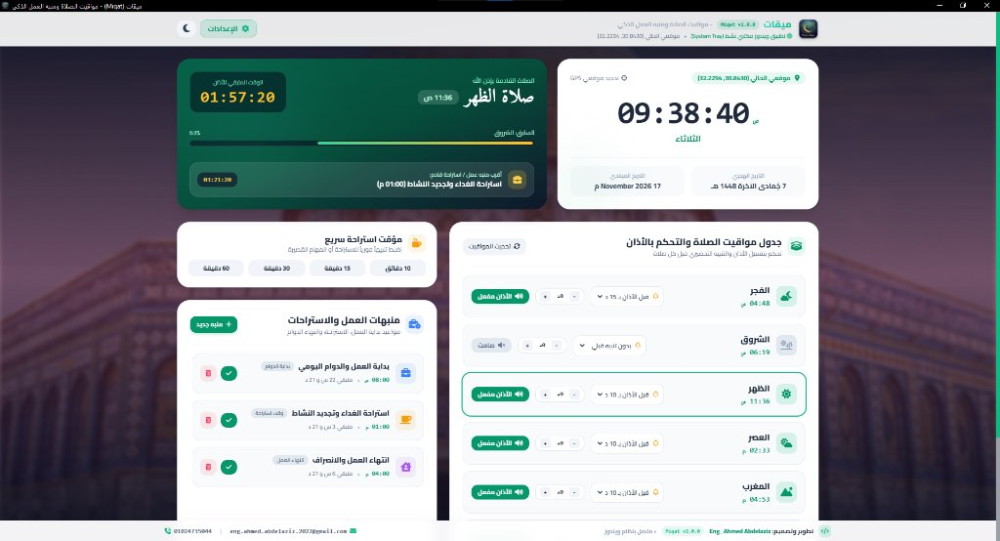
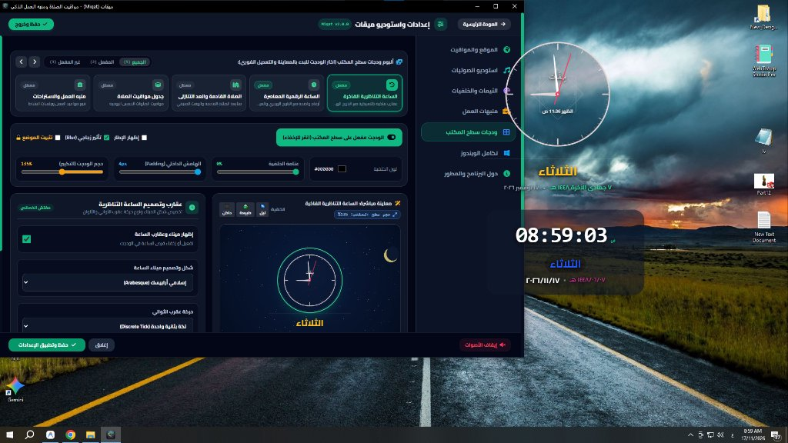
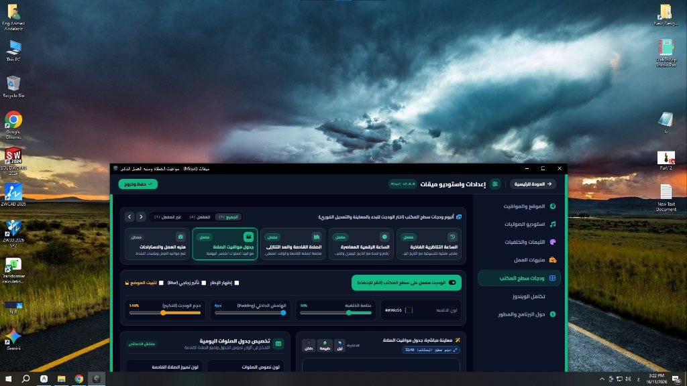
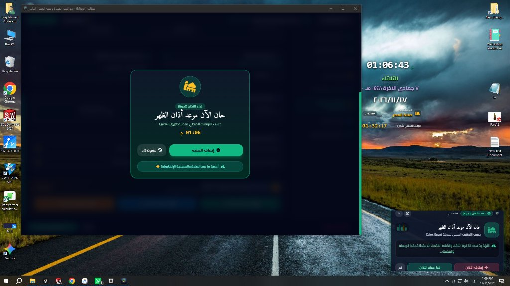
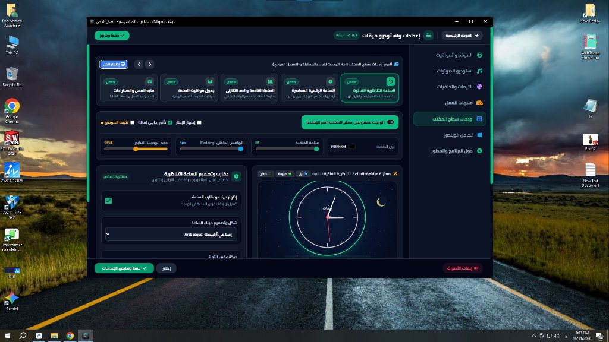

# 🕌 Miqat (ميقات) v2.0
> **Desktop Prayer Times & Smart Productivity Alarm for Windows 10 & 11**
> 
> A modern, lightweight desktop app built with **Tauri v2** and **Rust**, featuring an acrylic glassmorphism user interface designed with modern web technologies.

---



---

## 📽️ Animated Showcase Preview



> 🎥 **Full HD Showcase Video (1080p):** Download or preview the video walkthrough here: [assets/github/miqat-showcase.mp4](assets/github/miqat-showcase.mp4).

---

## ✨ Key Features

### 1. Accurate Prayer Times & Automated Adhan
- Covers **22 Arab countries** and global coordinates with automatic or manual GPS detection.
- **Daylight Saving Time (DST)** quick toggle.
- Real-time countdown clock and percentage-based progress bar.
- Pre-prayer preparation reminders (5 to 30 minutes before Adhan).
- Post-prayer supplications window and built-in interactive digital tasbeeh counter.

### 2. Work & Productivity Alarms
- Unlimited daily schedules for work start, lunch break, and end of shift.
- Quick Pomodoro / Break timer with presets for 10, 15, 30, and 60 minutes.
- Smart bottom status bar showing active alarms and closest countdown with quick toggle-all controls.

### 3. Acrylic Desktop Popup Notification
- Elegant glassmorphic popup floating above the Windows taskbar clock.
- Real-time audio waveform equalizer synchronized during sound playback.
- Instant actions: Stop Audio, Play Supplication, or Snooze for 5 minutes.
- 6 customizable display positions across the screen with scale and opacity controls.


### 4. Transparent Desktop Floating Widgets
- Detached, free-floating analog and digital clocks with Arabic and classical dials.
- Drag-and-drop placement with position lock.
- Automatic persistence of positions, scales, and colors across reboots.

---

## 📸 Screenshots Gallery

| Dark Mode Dashboard | Light Mode Dashboard |
| :---: | :---: |
|  |  |

| Transparent Desktop Widgets | Audio Studio & Supplications |
| :---: | :---: |
|  |  |

| Taskbar Popup Notification | Country & Method Settings |
| :---: | :---: |
|  |  |

---

## 🛠️ Tech Stack

- **Backend:** Rust 2024, Tauri v2
- **Frontend:** HTML5, Tailwind CSS, Vanilla JavaScript
- **Audio:** Web Audio API & Native Media Playback
- **Storage:** LocalStorage & IndexedDB (Offline-first architecture)
- **OS Support:** Windows 10 / Windows 11 (64-bit)

---

## 🚀 Getting Started

### Portable Executable
Run `Miqat.exe` directly without any installation needed.

### Build from Source
1. Make sure **Rust** and **Node.js** are installed.
2. Install dependencies:
   ```bash
   npm install
   ```
3. Run development mode:
   ```bash
   npm run tauri dev
   ```
4. Build release executable:
   ```bash
   npm run tauri build
   ```

---

## 👨‍💻 Author & Contact

- **Developer:** Eng. Ahmed Abdelaziz
- **Phone / WhatsApp:** `+20 1024735044`
- **Email:** `eng.ahmed.abdelaziz.2022@gmail.com`
- **License:** Open source for personal and community development.
