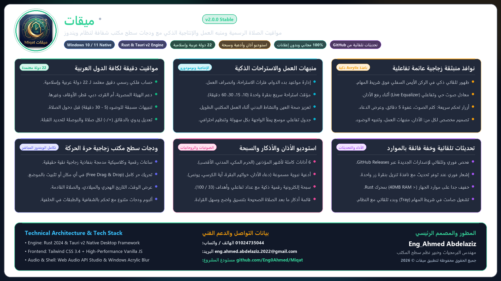
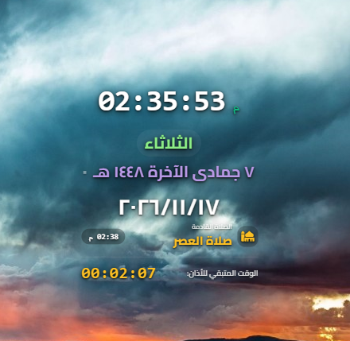
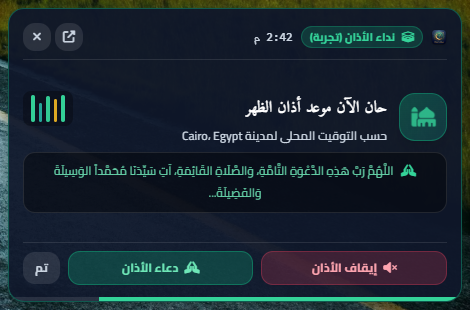
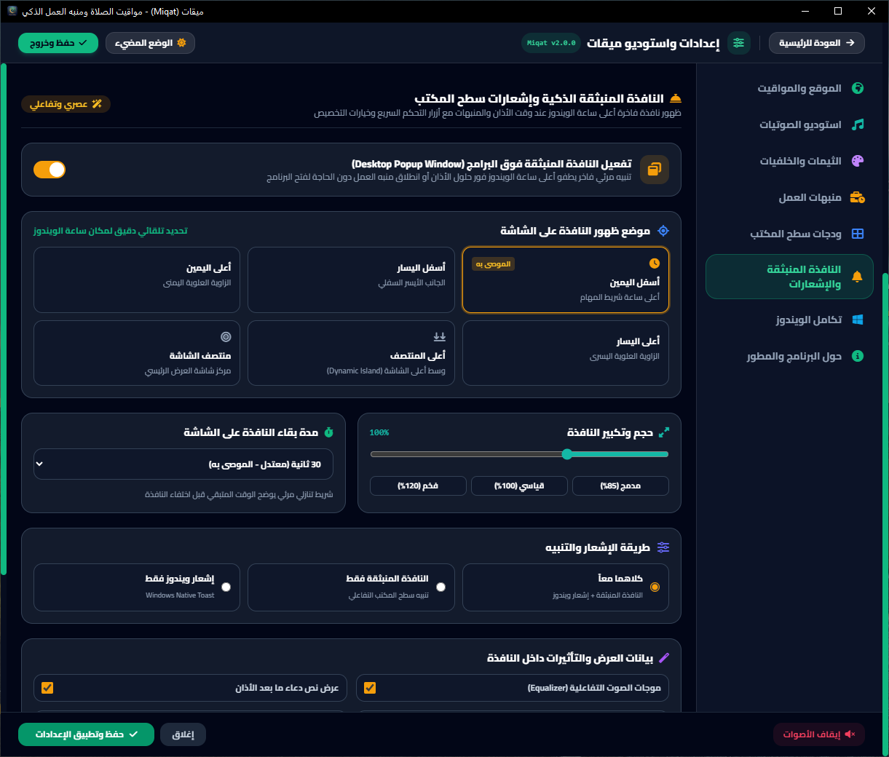
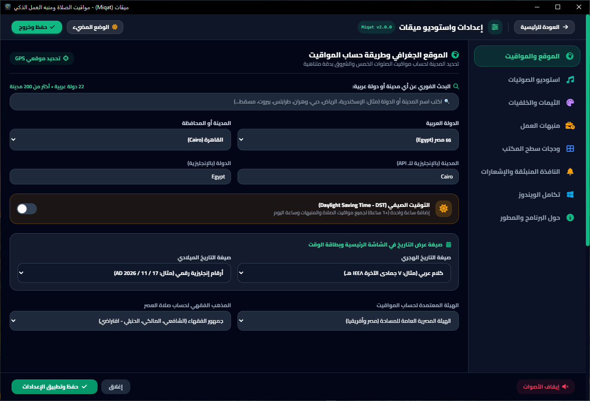
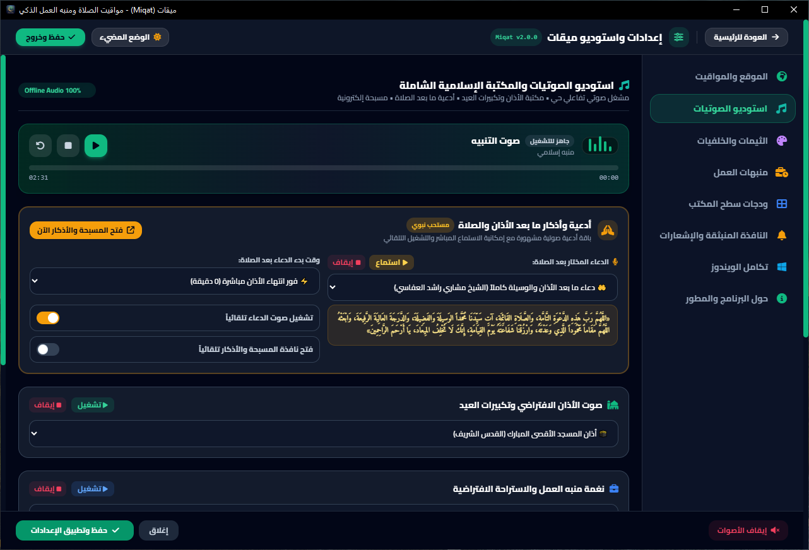

# 🕌 Miqat (ميقات) v2.0 Pro
> **Desktop Prayer Times & Smart Productivity Alarm for Windows 10 & 11**
>
> A state-of-the-art native desktop companion built with **Tauri v2** and **Rust 2024**, featuring an ultra-fast backend engine and an elegant acrylic glassmorphism user interface designed with **Tailwind CSS**.

---

## 🌟 Comprehensive Master Overview



---

## ✨ Key Features & Capabilities

### 1. 🕋 Official Prayer Times & Automated Adhan for 22 Arab Countries
- Astronomical calculation verified across **22 Arab and Islamic nations** (Egyptian General Authority of Survey, Umm Al-Qura Makkah, Dubai, Qatar, Diyanet Turkey, Muslim World League, and more).
- Real-time countdown timer and precision progress bar for the upcoming prayer.
- Pre-prayer ablution (Wudu) reminder (5 to 30 minutes in advance).
- Manual minute-by-minute fine-tuning adjustments (+/-) and integrated Qibla compass.

### 2. 💼 Work Alarms, Pomodoro Productivity & Quick Break Timer
- Comprehensive scheduling for work start, energy boost break, and shift completion.
- One-click Quick Break timer (10, 15, 30, and 60 minutes) to prevent digital eye strain and maintain physical wellness.
- Expanded interactive alarms table fully integrated into the main dashboard.

### 3. 🪟 Acrylic Glassmorphic Desktop Popups
- Smart glassmorphic notification floating gracefully above the Windows taskbar in the bottom-right corner.
- Synchronized **Live Audio Equalizer** reacting dynamically in real time during Adhan playback.
- Quick action controls: Mute audio, 5-minute snooze, and view the post-Adhan supplication.
- Contextual layouts tailored specifically for: Adhan alerts, work tasks, and pre-prayer reminders.

### 4. 🕒 Transparent Desktop Floating Widgets
- Detached, free-floating analog and digital desktop clocks with authentic glassmorphism transparency.
- Full **Free Drag & Drop** functionality across multiple monitors or lock-in-place mode.
- Live display of current time, Hijri and Gregorian dates, and next prayer countdown.

### 5. 🎙️ Audio Studio, Digital Tasbeeh & Prophetic Azkar
- Curated audio library with 6 complete Adhans from Makkah, Madinah, Al-Aqsa, Abdulbasit, Al-Afasy, and Al-Qatami.
- High-fidelity prophetic recitations (Post-Adhan Dua, Ayat Al-Kursi, Baqarah Endings, Yunus Dua, Rabbana Atina).
- Smart interactive digital Tasbeeh counter with bead haptics and goal targets (33 / 100).
- Authentic post-prayer supplications formatted for comfortable reading.

### 6. ⚡ Smart Auto-Updates & Ultra-Lightweight Rust Performance
- Automatic check for new versions via **GitHub Releases** with one-click in-app updater.
- Ultra-low system memory footprint (< 40MB RAM) powered by the Rust backend engine.
- Silent minimize-to-tray and seamless Windows startup integration.

---

## 📸 Authentic Screenshots Gallery

### 1. Floating Desktop Widgets
| Full Windows Desktop with Transparent Floating Clocks | Closeup of Digital Clock & Next Prayer Countdown |
| :---: | :---: |
|  |  |

---

### 2. Smart Acrylic Taskbar Popups
| Adhan Popup with Live Waveform Equalizer | Work & Task Productivity Alarm | Pre-Prayer Ablution Reminder |
| :---: | :---: | :---: |
|  |  |  |

---

### 3. Adhan Ringing Modal & Spiritual Tools
| Main Adhan Ringing Modal | Smart Interactive Digital Tasbeeh | Authentic Post-Prayer Azkar List |
| :---: | :---: | :---: |
|  |  |  |

---

### 4. Settings & Customization Studio
| Location, 22 Arab Countries & Calculation Methods | Audio Studio, Adhan & Supplication Catalog |
| :---: | :---: |
|  |  |

| Themes, Mosque Wallpapers & Glass Opacity | Desktop Widgets Album & Pinning Options |
| :---: | :---: |
|  |  |

---

## 🛠️ Technical Architecture & Tech Stack

- **Backend Engine:** Rust 2024 / Tauri v2 Native Desktop Framework
- **Frontend Layer:** Tailwind CSS 3.4 & High-Performance Vanilla JavaScript
- **Audio Processing:** Web Audio API with real-time spectrum analysis
- **Native Windows Shell:** Windows Acrylic Blur effect, Single Instance Lock, and Global System Hotkeys
- **Data Persistence:** LocalStorage & IndexedDB (100% Offline-First)
- **Supported Platforms:** Windows 10 & Windows 11 (64-bit architectures)

---

## 🚀 Getting Started

### Portable Executable
Download and launch `Miqat.exe` directly without any installation required.

### Build from Source
1. Ensure **Node.js** (v18+) and **Rust** (v1.75+) are installed.
2. Install dependencies:
   ```bash
   npm install
   ```
3. Run in local development mode:
   ```bash
   npm run tauri dev
   ```
4. Build the release binary:
   ```bash
   npm run tauri build
   ```

---

## 👨‍💻 Author & Contact Details

- **Lead Designer & Developer:** Eng. Ahmed Abdelaziz (**Eng_Ahmed Abdelaziz**)
- **Title:** Software Engineer & Desktop Systems Specialist
- **Phone / WhatsApp:** `+20 1024735044`
- **Email:** `eng.ahmed.abdelaziz.2022@gmail.com`
- **GitHub Repository:** [https://github.com/Eng0Ahmed/Miqat](https://github.com/Eng0Ahmed/Miqat)

---

> **Copyright Notice:** Developed and designed by Eng_Ahmed Abdelaziz © 2026. All rights reserved. Open-source and freely distributed for the benefit of users worldwide.
